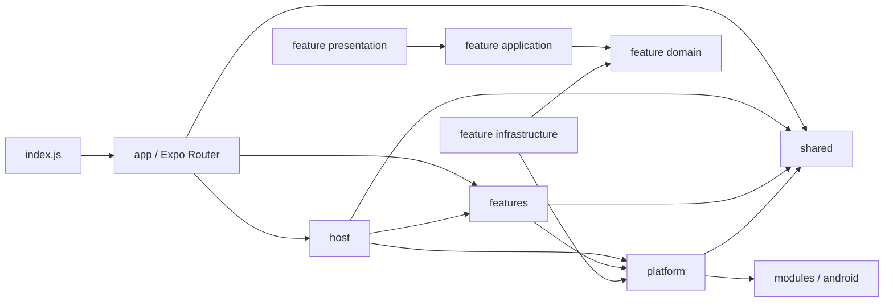

# RavenCat 架构导航

> 本文用于日常定位代码与检查依赖边界；完整文件树见 `docs/architecture-snapshot.md`。


## 1. 最短定位口诀

先判断问题属于哪个 Feature，再判断职责层：

```text
界面和交互 -> presentation / shell
流程和状态 -> application
业务概念与端口 -> domain
SQLite、原生或外部服务适配 -> infrastructure
路由文件与布局 -> app
跨 Feature 组装 -> host
纯技术底座 -> platform
无业务归属的稳定复用 -> shared
```

| 现象 | 首选入口 | 下一步 |
|---|---|---|
| 聊天列表、输入、消息气泡异常 | `src/features/chat/presentation/shell/`、`presentation/messages/` | 对应 Chat application |
| AI 回复、工具调用、分段投递异常 | `src/features/chat/reply/application/`、`reply/agent/` | `src/host/prompt/`、`src/host/composition/agent/`、`src/platform/ai/` |
| AI 提示词、语言、覆盖、工具权限或高级检查器异常 | `src/features/prompting/` | `src/host/prompt/catalog/`、`compiler/`、`preview/` |
| 通话状态、TTS、快照异常 | `src/features/calls/` | Calls infrastructure、`src/platform/device/` |
| 主动伴随、AI 日程执行异常 | `src/features/companion/` | Companion infrastructure、`src/host/composition/`、顶层 `modules/` |
| 悬浮层、气泡皮肤或悬浮交互异常 | `src/features/floatingLayer/` | Floating Layer infrastructure、`src/platform/device/`、顶层 `modules/` |
| 数据存取、锁库或迁移异常 | 对应 Feature infrastructure | `src/platform/persistence/runtime/`、`src/platform/persistence/sqlite/` |
| 主题、壁纸或通用控件异常 | `src/shared/theme/`、`src/shared/ui/` | 使用它的 Feature presentation |
| Expo Router 入口或布局异常 | `src/app/` | 自定义入口 `index.js` |
| 启动、外部导航或跨 Feature 连接异常 | `src/host/KimiPhoneHost.tsx`、`src/host/navigation/`、`src/host/composition/` | `src/app/_layout.tsx`、`index.js` |

## 2. 当前源码结构

```text
src/
├── app/          # Expo Router 路由与布局
├── host/         # 跨 Feature 组合、Prompt、工具注册与全局运行时编排
├── features/     # 业务模块；内部按需使用 domain/application/infrastructure/presentation
├── platform/     # AI、Android 设备能力与 SQLite 技术底座
└── shared/       # 主题、UI、头像、通用契约与无业务工具
```

旧横向根目录 `application / core / infrastructure / presentation` 已删除，不再提供兼容出口。

### app

- `_layout.tsx`：Expo Router 根布局；
- 其他路由文件：读取可序列化参数并渲染 Feature 公共页面入口。

### host

- `composition/`：负责各 Feature 的跨模块依赖组装与运行时注入，例如连接 Companion、Device Control 与 Floating Layer；
- `KimiPhoneHost.tsx`：全局 Provider、数据库启动、原生监听、通知、通话恢复与路由适配上下文；
- `navigation/`：外部导航目标解析，以及 Router 与受控 Feature 页面之间的宿主适配；
- `shell/`：全局壳层组件；
- `prompt/`：聚合内置目录、解析 Provider 与场景预设，并编译唯一的最终 Prompt Pack；
- `composition/agent/`：汇总各 Feature 的生产工具、冻结本轮授权并装配统一 Agent Runtime（不存在 `host/tools/` 目录）。

### features

每个业务模块只通过根 `index.ts` 向其他 Feature 暴露公共 API。模块内部允许相对导入；跨 Feature 禁止深导入。

Chat 因规模较大，继续按 `conversation / messages / group / reply / events / presentation` 子域组织；Agent Runtime 的模型网关、任务与投影收拢在 `reply/agent/`，界面按 `presentation/{shell,conversation,group,messages}` 收拢。

`features/prompting/` 拥有按 AI 隔离的内置正文覆盖、启用状态、用户提示词、工具权限配置和提示词中心 UI；主聊天内置正文固定为中文，用户正文保留原文；`host/prompt/` 只负责跨 Feature 目录聚合与运行时编译。2.x 历史预设、绑定和自定义片段只保留只读升级兼容，3.0 删除；不再提供旧预设编辑入口。Feature 不得反向依赖 Host。

### platform

- `ai/`：文本模型 Provider、流式响应、模型发现与错误映射；
- `device/`：Android 通知门面、媒体、本地文件与实时语音；
- `persistence/`：SQLite 唯一协调器、单写者队列、有界读取、连接、schema、migration 和通用维护能力。

业务 Repository adapter 不属于 platform，必须留在对应 Feature 的 `infrastructure/`。

Android 系统消息通知与来电通知统一由顶层 `modules/kimiphone-notifications/` 实现。Feature 只决定业务触发条件，`platform/device` 负责窄门面，Host 统一消费点击响应并校验导航目标。项目不保留系统通知失败时的应用内横幅兜底；RavenCat 前台服务常驻通知仍由其原生 Service 持有生命周期，但使用独立低打扰渠道。

### shared

- `aiTools/`：Feature 工具与 app 注册中心共享的工具上下文和类型；
- `prompt/`：Prompt 组装输入输出契约；
- `theme/`、`ui/`、`avatar/`：跨 Feature 的表现层基础；
- `utils/`、`kernel/`：稳定且无业务归属的工具与基础常量。

## 3. 依赖图



禁止的反向关系：

- `shared` 依赖 app、host、features 或 platform；
- `platform` 依赖 app、host 或 features；
- `features` 依赖 app 或 host；
- `host` 依赖 app；
- `app` 直接依赖 platform；
- Feature application 直接依赖同 Feature 的具体 infrastructure；
- 跨 Feature 深度导入私有文件。

## 4. 公共导入方式

```ts
import { sendUserMessage } from '@features/chat';
import { databaseCoordinator } from '@platform/persistence';
import { Button } from '@shared/ui';
import { useTheme } from '@shared/theme';
```

Feature 内部可以使用相对路径；普通源码跨根目录优先使用 `@host / @features / @platform / @shared` 别名。路由文件由 Expo Router 发现，不提供 `@app` 别名。

Expo Router 是唯一页面导航系统。`src/app` 与 `src/host/navigation` 持有具体路径和导航执行，Feature 通过回调或导航 context 表达业务意图。全局 Provider 与宿主生命周期由根布局持有，聊天会话状态在路由栈间共享。导航修改按实际范围验收返回栈、通知深链、通话跳转和页面焦点，不以静态检查代替设备行为。

## 5. 按范围验证

以下是可选检查入口，不是每次修改都要运行的完整清单；选择规则见 AGENTS §13。

```bash
npm run typecheck
npm run lint
npm run architecture:aliases
npm run architecture:check
npm run architecture:styles
npm run architecture:cycles
npm run architecture:snapshot:check
npm run verify:prompt
```

`architecture:check` 中的边界违规均按错误处理。`architecture:styles` 会先运行自测，再检查 `src/` 下的样式职责文件；`styles.ts`、`*.styles.ts` 以及主要创建 `StyleSheet` 的 `*Styles.ts` / `*Style.ts` 文件超过 300 行时会直接失败。`npm run verify:architecture` 已包含这项门禁。项目只面向 Android，不保留 iOS 分支或 iOS 专属主题。
